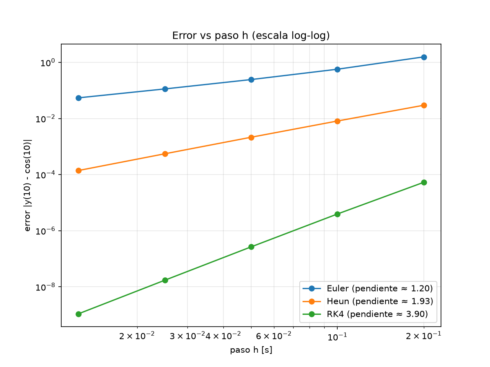
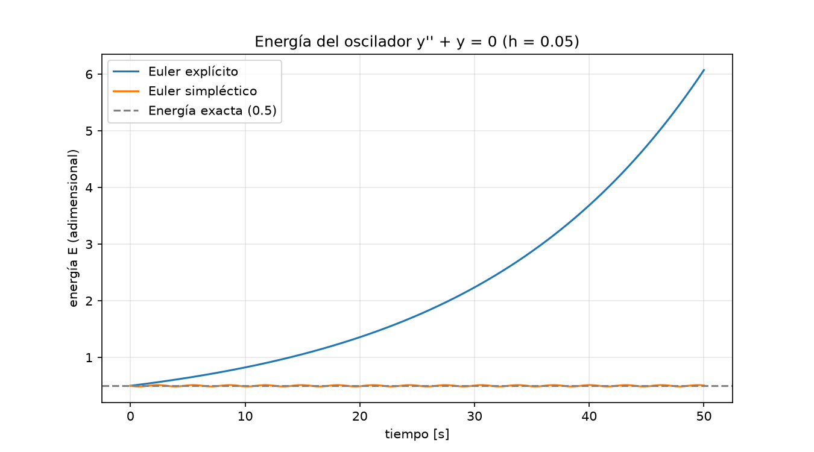

# Proyecto 3: ¿Qué tan bueno es su integrador?

Ecuaciones Diferenciales, Unidad 3
Institución Universitaria Colegio Mayor del Cauca

Integrantes: Ana Rocio Maya Cruz
             Jhonny Anderson Ordoñez Gomez
             Jose Luis Martinez Mosquera

## De qué trata

Resolvemos y'' + y = 0 con y(0) = 1 y y'(0) = 0, cuya solución exacta es y(t) = cos t. La pasamos a sistema de primer orden con u = y y v = y':

    u' = v
    v' = -u

Y la integramos con cuatro métodos: Euler, Heun, Runge-Kutta 4 y Euler simpléctico. Después comparamos cada uno con cos t y miramos qué pasa con la energía E = 1/2 (y² + y'²), que en la solución exacta vale siempre 0.5.

La deducción a mano está en la carpeta `analitico/` de este repositorio (subir ahí las fotos o el PDF de la solución).

## Qué hay en cada carpeta

    back/                  código en Python
      integradores.py      los métodos (Euler, Heun, RK4, simpléctico)
      orden.py             errores en t = 10 y orden de cada método
      grafica_error.py     gráfica error vs h, guarda error_vs_h.png
      energia.py           gráfica de energía, guarda energia.png
      main.py              servidor (FastAPI) que usa la página
      requirements.txt     librerías de Python
    front/                 la página con gráficas y animación (React)
    analitico/             deducción a mano (fotos o PDF)
    energia.png            resultado de energia.py
    error_vs_h.png         resultado de grafica_error.py

## Cómo correrlo

Se abre la carpeta `ProyectED-main` en Visual Studio Code y se usan dos terminales de PowerShell (menú Terminal, Nueva terminal). La primera enciende el servidor y la segunda la página. Hace falta tener Python y Node.js instalados.

### Terminal 1: servidor

```powershell
cd back
```

```powershell
python -m venv .venv
```

```powershell
.venv\Scripts\activate
```

Si PowerShell dice que la ejecución de scripts está deshabilitada, correr esto y volver a activar:

```powershell
Set-ExecutionPolicy -Scope Process -ExecutionPolicy Bypass
```

```powershell
pip install -r requirements.txt
```

```powershell
uvicorn main:app --reload
```

Dejar esta terminal abierta. Debe decir que el servidor corre en `http://127.0.0.1:8000`.

### Terminal 2: página

Abrir una terminal nueva (el símbolo + en el panel de terminales), sin cerrar la primera:

```powershell
cd front
```

```powershell
npm install
```

```powershell
npm run dev
```

La terminal muestra una dirección, normalmente `http://localhost:5173`. Abrirla en el navegador. Arriba a la derecha debe decir "API conectada". Si dice "API sin conexión", la Terminal 1 se cerró o no está encendida.

Para apagar todo, Ctrl + C en cada terminal.

### Scripts sueltos (opcional)

Con el entorno virtual de la Terminal 1 activado y dentro de `back`, también se pueden correr por separado: `python orden.py` (errores y órdenes), `python grafica_error.py` (guarda `error_vs_h.png`) y `python energia.py` (guarda `energia.png`). Las dos gráficas ya vienen en el repositorio.

## Qué encontramos

### Comparación con la solución exacta

Con h = 0.1, el valor de y(10) comparado con cos(10) = -0.839072:

| Método | y(10)     | Error     |
|--------|-----------|-----------|
| Euler  | -1.408847 | 0.570     |
| Heun   | -0.830954 | 0.0081    |
| RK4    | -0.839075 | 0.0000039 |

RK4 prácticamente se encima con la curva exacta. Heun se separa un poco. Euler se separa mucho y además la amplitud le va creciendo. La diferencia viene de que cada método cambia la curva por pasos rectos de tamaño h y en cada paso comete un error pequeño, que se va sumando. Entre más alto el orden del método, menos error por paso.

### Orden de los métodos

Usando orden ≈ log2( e(h) / e(h/2) ) con h = 0.1, 0.05 y 0.025:

| Método | Orden medido | Orden teórico |
|--------|--------------|---------------|
| Euler  | 1.22 y 1.11  | 1             |
| Heun   | 1.92 y 1.96  | 2             |
| RK4    | 3.89 y 3.95  | 4             |

En la gráfica log-log (`error_vs_h.png`) las pendientes dan 1.20, 1.93 y 3.90. Euler da un poquito más de 1 porque con h grande todavía no está en su comportamiento límite; se acerca a 1 cuando h baja.



### Energía en 50 segundos (h = 0.05)

| Método            | Energía final |
|-------------------|---------------|
| Euler explícito   | 6.07          |
| Euler simpléctico | 0.506         |

La exacta es 0.5. En cada paso, Euler explícito multiplica la energía por (1 + h²), y como siempre es mayor que 1, la energía solo sube: 0.5 · (1.0025)^1000 ≈ 6.07, que es lo que dio el programa. El simpléctico oscila entre 0.488 y 0.513 pero no se va de ahí, porque al usar la velocidad nueva para actualizar la posición no se infla la energía.

El simpléctico también es de orden 1 (el error baja a la mitad cuando h baja a la mitad), o sea que no es más preciso en un instante dado. Su ventaja es que aguanta mucho tiempo sin desarmarse.



### Animación de péndulos

Está en la página, en la sección 5: dos péndulos lado a lado, uno con el método que se escoja (por defecto Euler) y otro siempre con Euler simpléctico. Con el tiempo el de Euler se acelera solo y el otro se mantiene igual. Es la misma diferencia que se ve en la gráfica de energía.

## Conclusión

- Para una simulación corta donde importa la precisión, RK4. Con h = 0.1 ya da un error de 10^-6.
- Para una simulación larga donde la energía tiene que mantenerse (juegos, motores de física, órbitas), Euler simpléctico. Cuesta lo mismo que Euler y no se desarma.
- Euler explícito no sirve para osciladores: tiene error grande y además le va metiendo energía al sistema.
- Un método de orden bajo que respeta la estructura del problema puede ser mejor que uno de orden alto que no la respeta.

## Limitaciones

- El Euler simpléctico de `integradores.py` solo sirve para y'' + y = 0, porque la ecuación está escrita dentro de la función. Los otros tres métodos reciben cualquier f.
- La animación de péndulos usa y(t) del oscilador lineal como ángulo, así que muestra cómo se comportan los integradores, no el péndulo real (eso es otro proyecto).

## Uso de inteligencia artificial

Usamos dos herramientas:

- **OpenCode:** asistente de IA para programar desde la terminal y el editor. Nos ayudó a organizar la parte de las gráficas para que fueran interactivas en la página.
- **Claude:** asistente de IA de conversación. Nos ayudó en el análisis de los resultados y en la verificación del funcionamiento del proyecto.

La parte analítica a mano y se entrego a la profesora

## Referencias

- Edwards y Penney, Ecuaciones diferenciales y problemas con valores en la frontera, cap. 3.
- Zill, Ecuaciones diferenciales con aplicaciones de modelado, caps. 3 y 5.
- Hairer, Lubich y Wanner, Geometric Numerical Integration, capítulo introductorio.